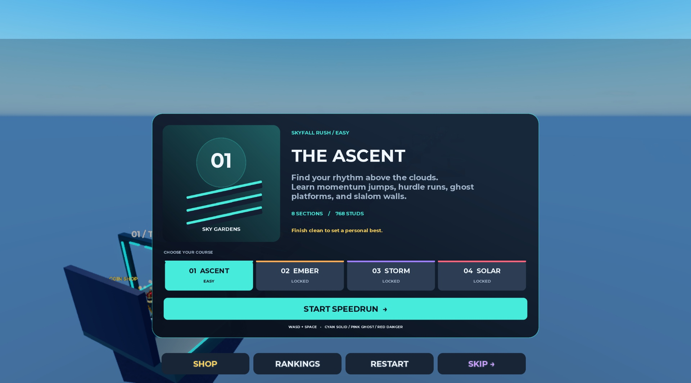
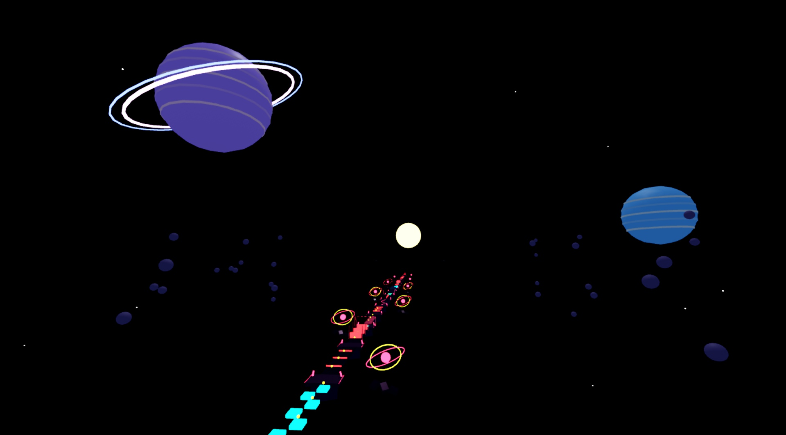
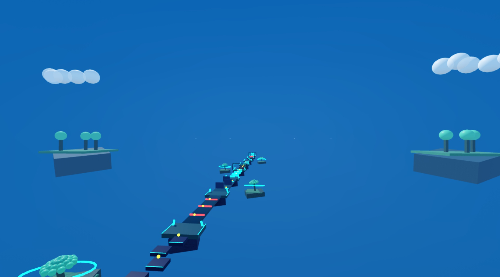

# Skyfall Rush

**A four-course Roblox speedrun obby with server-owned timing, checkpoint progression, competitive records, and a cosmetic economy.**

Built in **Luau** for **Roblox Studio**, with a **Rojo + VS Code** source workflow.



## The game

Race across floating courses that become longer and harder. Chain jumps, read solid/ghost platforms, ride moving ferries, dodge machinery, and collect optional coins for trails and auras. Every checkpoint separates four obstacle sections.

| Course | Difficulty | Sections | Length | Visual identity |
| --- | --- | ---: | ---: | --- |
| The Ascent | Easy | 8 | 768 studs | Hanging sky gardens |
| Ember Ruins | Medium | 12 | 1,152 studs | Broken foundry arches |
| Stormworks | Hard | 16 | 1,536 studs | Storm-harvesting turbines |
| Solar Collapse | Expert | 20 | 1,920 studs | Orbital reactor fragments |

**56 sections · 12 obstacle patterns · 5,376 studs · 6 cosmetics**

## Try the Studio prototype

[Download SkyfallRush.rbxlx](https://github.com/Alyzzini/skyfall-rush/releases/download/v0.3.3/SkyfallRush.rbxlx) from the [v0.3.3 release](https://github.com/Alyzzini/skyfall-rush/releases/tag/v0.3.3), open it in Roblox Studio, and press **Play → Start Speedrun**. The updated download includes the hand-edited world, enclosed 3D worlds, transparent fall catcher, source and builders. You do not need Rojo to open it.

### Visibility fix (v0.3.3)

Removed whole-course transparency masking that could leave platforms invisible after switching courses or restarting. Shared obstacles remain available to all players. Lighting and collected coin visuals remain local to each player; collected coins also retain their state when streamed back in. Phase timing, transparent hazards, the hand-edited world and compact rest sizes are preserved.

### Latest balance fix: permanent phase rests

All six Phase Steps sections now have a centered, anchored **3.5 × 0.5 × 4 stud resting platform** with green edges and an **ALWAYS SOLID** sign. It never phases, crumbles or moves. The remaining phase pads retain their timing. The installer detects every phase chain and runs for saved worlds and generated worlds alike. This is a resting spot, not an extra checkpoint. The installer now migrates the old oversized platforms once, then preserves later manual Size edits instead of resetting them every startup.

### Latest update: enclosed 3D worlds

Each course is enclosed by a **visible, rounded sky shell**, with 3D scenery inside. The distant shell uses the same unlit color on every surface to disguise panel joins and avoids square wall/ceiling corners. Every course and its enclosure remain visible whenever streamed in. The enclosing scenery and course separation conceal neighboring levels without hiding their obstacles.

| Course | Surrounding 3D world |
| --- | --- |
| The Ascent | Floating garden islands, distant trees, cloud banks and a cloud sea below |
| Ember Ruins | Obsidian cliffs, glowing ember fissures, ruined arches and a setting sun |
| Stormworks | Storm-cloud volumes, steady lightning shapes, collector rings and spires |
| Solar Collapse | Ringed planets, cloud bands, asteroid fields and a surrounding star field |

The course centers remain 4,096 studs apart. The enclosure spans about 2,500 studs across and curves around both ends. Scenery sits away from the playable route and the supported 512-stud camera zoom. It cannot collide or obstruct camera ray queries. The user's edited tree islands and invisible bottom hazard remain intact.






## Features

- **Speedrun integrity:** server-owned elapsed time, sequential route gates, fall penalties, individual course records and a full-campaign board.
- **Skip-aware rankings:** the free skip prototype advances to the next checkpoint, removes the current time, displays `USED SKIP`, and disqualifies that run and campaign from rankings.
- **Cosmetic economy:** server-validated coin purchases, ownership, re-equipping, four trails and two auras; cosmetics do not change movement speed.
- **Persistence implementation:** profile sanitization, session leases, autosaves, retry handling and OrderedDataStore records. Unpublished places use a clearly labeled session-only preview.
- **Responsive interface:** illustrated course cards, a collapsible race menu, visual catalog previews, podium-styled ranking rows and a menu overview camera.
- **Split coaching:** cumulative checkpoint comparisons against the best split at that checkpoint in the current client session.
- **Procedural world:** reproducible builders for platforms, hazards, checkpoints, scenery and animated decorative turbines/reactor rings.

## Open in VS Code

```sh
git clone https://github.com/Alyzzini/skyfall-rush.git
cd skyfall-rush
code SkyfallRush.code-workspace
```

The workspace recommends the Rojo and Luau extensions. Follow the [official Rojo installation guide](https://rojo.space/docs/v7/getting-started/installation/) for the CLI and matching Roblox Studio plugin. The VS Code Rojo extension also provides a build/serve menu; it does not put `rojo` on your terminal PATH.

On Windows, run the **Rojo: setup local CLI (Windows)** VS Code task once, followed by **Rojo: build place**. This downloads pinned Rojo 7.7.1 from its official release into the ignored `.tools` directory. It does not alter your system PATH. The Windows build/serve tasks use that local copy. Alternatively, install the pinned tools with Rokit using the included `rokit.toml`.

### Build and play

```sh
rojo build default.project.json --output SkyfallRush.rbxlx
```

Open `SkyfallRush.rbxlx` in Roblox Studio and press **Play**, then **Start Speedrun**. The build loads the checked-in edited world snapshot. Startup configures the course environments before the HUD and race runtime begin. Procedural generation is retained only as a fallback if the world is absent.

### Live editing

```sh
rojo serve default.project.json
```

Connect the Rojo Studio plugin to the local server. Source edits in VS Code then sync into Studio. For other platforms the included tasks expect the CLI on PATH; Windows tasks use the local setup described above. This repository does not automatically publish to Roblox.

To create an editable world while Studio is stopped, connect Rojo and run this in Studio's **Command Bar**:

```lua
require(game.ServerStorage.SkyfallBuildTools.BuildCourse)
require(game.ServerStorage.SkyfallBuildTools.ArtDirection)
```

**These builders recreate the baseline geometry and art. They do not reproduce later manual tree edits.** The current hand-edited world is stored separately in `src/world/SkyfallSprint.rbxm` and is the default source for builds. The course builder backs up an existing world into ServerStorage before rebuilding. ModuleScripts cache their results within a Studio session.

## Project layout

```text
src/
  client/    HUD, menus, input, camera, local animation and ferry carry
  server/    Race state, route validation, purchases, profiles and records
  shared/    Course, movement, catalog and persistence configuration
  build/     Baseline installers and course environment layout
  world/     Saved, hand-edited world snapshot
docs/
  images/    In-game screenshots
  ARCHITECTURE.md
  PORTFOLIO.md
  STUDIO-NOTES.md
default.project.json
SkyfallRush.code-workspace
```

See [architecture and tradeoffs](docs/ARCHITECTURE.md), [portfolio/résumé notes](docs/PORTFOLIO.md), and [detailed Studio setup and QA notes](docs/STUDIO-NOTES.md).

## Keep Studio edits in source control

Disconnect live Rojo sync before manually editing geometry. Save `SkyfallRush.rbxlx` in this project folder, then export the current world with Python 3:

```sh
python scripts/Export-World.py
```

This updates `src/world/SkyfallSprint.rbxm`, which future Rojo builds and GitHub source downloads use. The exporter preserves editable instances and shared-string data, omitting two derived model render-cache properties that Roblox regenerates. Review and commit the updated model before reconnecting Rojo. Raw place builds, local tools and `.backups` remain ignored by Git; the current Studio file is distributed separately through Releases.

## Current status and limitations

This is a playable development prototype, not a released live service. Desktop interactions and simulated phone layouts have been inspected. The latest visual pass did not include a full manual completion of all 56 sections or profiling on low-end physical devices.

- **Global data:** the original Studio place is unpublished. Live cross-server persistence, session recovery under real outages and production leaderboard operations still need published-environment validation.
- **Purchases:** skip is explicitly free. `SkipProductId = 0` is a placeholder; a real Robux product requires server receipt handling before it can charge users.
- **Fair play:** ordered gates and movement checks are basic validation, not a complete anti-cheat system. Clients handle presentation; the server controls purchases and record submission.
- **Mobile:** layouts were inspected with Studio's iPhone simulator. Real-device touch interaction, accessibility and performance need additional coverage.
- **Scenery:** new decoration is noncolliding. Only the selected course's decorative rotors animate, at about 30 updates per second.

## Design references

[Roblox UI/UX guidance](https://create.roblox.com/docs/production/game-design/ui-ux-design) informed information hierarchy and menu grouping. [Obby player discussion](https://www.reddit.com/r/robloxgamedev/comments/1qylwty/what_do_you_enjoy_most_about_obby_platformers_in/) inspired cohesive course themes and stage variety. The project uses procedural parts and code-drawn interface previews; no third-party model pack is required.

## Development

Created by **Ameer (@Alyzzini)**. The source is published for portfolio review; no open-source license has been selected. Roblox and third-party tools retain their respective rights.
