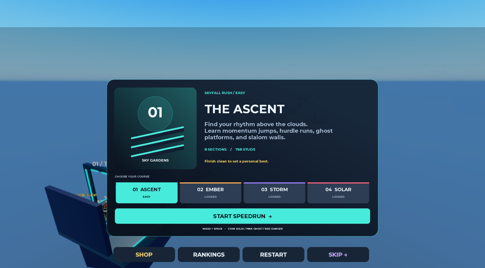

# Skyfall Rush

A Roblox speedrun platformer with twelve themed courses, timed obstacle runs, progression, and a cosmetic economy.



*In-game capture from the original four-course chapter. The current source contains twelve courses.*

**Luau · Roblox Studio · Rojo · VS Code**

[Try the Studio prototype](https://github.com/Alyzzini/skyfall-rush/releases/tag/v0.11.1) · [Explore the architecture](docs/ARCHITECTURE.md) · [Development history](docs/CHANGELOG.md)

## Project status

**Development prototype, available as source and a Studio download.** The original place is unpublished; this repository does not represent a released live service.

The latest review covered all twelve courses in Studio Edit mode and checked structure and source. **Gameplay testing remains with the owner.** Levels 9–12 have not had a Play-mode validation pass; full traversal of the expansion and current route revisions is also pending. Earlier desktop interaction checks and simulated phone layouts do not establish real-device readiness.

Live cross-server persistence, multiplayer latency, physical touch controls, accessibility, and low-end performance still require validation. See the [quality review](docs/QUALITY-REVIEW.md) for the exact checks and remaining playtest work.

## What the project implements

- **Race progression:** server-owned elapsed time, ordered route gates, checkpoints, fall penalties, and per-course records.
- **Ranking eligibility:** the free prototype skip advances progress while marking the run unranked and withholding its leaderboard time.
- **Cosmetic economy:** coins, an 18-item trail/aura catalog, and server-side purchase and ownership checks.
- **Persistence:** profile sanitization, session leases, retry handling, autosaves, and OrderedDataStore record submission, with a session-only preview for unpublished places.
- **Player interface:** course selection, a race HUD, cosmetic previews, rankings, music/effects controls, and adjustable visual detail.
- **World authoring:** reusable Luau builders plus a preserved, hand-edited world model that is included in source builds.

Route and movement checks are basic validation, not a complete anti-cheat system. Skip is free: `SkipProductId = 0` is a placeholder, and paid skip purchases are not implemented.

## Course design

The [current configuration](src/shared/SkyfallConfig.luau) defines **12 courses, 96 sections, and 18 cosmetics**. Each course has eight sections; checkpoint spacing varies by chapter.

| Chapter | Courses | Design focus |
| --- | --- | --- |
| Original · 1–4 | The Ascent, Ember Ruins, Stormworks, Solar Collapse | Precise jumps, phase timing, moving platforms, ruins, and reactor hazards |
| Expansion · 5–8 | Clockwork Docks, Prism Archive, Pulse Citadel, The Convergence | Machinery, powered bridges, laser timing, and combined obstacle sequences |
| Advanced · 9–12 | The Great Engine, Cloudspire, Chrono Nexus, Skyfall Apex | Rotating carriers, a tower climb, traveling openings, and signal-floor patterns |

Read the [route design notes](docs/LEVEL-DESIGN.md), [expansion notes](docs/EXPANSION-5-8.md), and [advanced chapter notes](docs/ADVANCED-9-12.md) for mechanics and testing boundaries.

## Source architecture

| Location | Responsibility |
| --- | --- |
| [src/server](src/server) | Race state, route validation, purchases, profiles, records, and obstacle simulation |
| [src/client](src/client) | HUD, menus, camera/input, audio feedback, and local visual effects |
| [src/shared](src/shared) | Course definitions, movement settings, cosmetic catalog, and audio configuration |
| [src/build](src/build) | Course builders, environment layout, model organization, and visual polish |
| [src/world](src/world) | Preserved editable world snapshot used by Rojo builds |
| [default.project.json](default.project.json) | Rojo mapping from source files into Roblox services |

The server handles progression, purchases, and record submission; clients handle presentation and local input. The [architecture guide](docs/ARCHITECTURE.md) explains the implementation and its tradeoffs in more detail.

## Open the prototype

1. Download [SkyfallRush.rbxlx from v0.11.1](https://github.com/Alyzzini/skyfall-rush/releases/download/v0.11.1/SkyfallRush.rbxlx).
2. Open it in Roblox Studio. Rojo is not required for the download.
3. Press **Play**, choose a course, select **Enter Course**, and cross the blue start gate.

The release includes the saved world, scripts, and builders. Treat it as a prototype for inspection and playtesting, with the limitations above.

## Work with the source

```sh
git clone https://github.com/Alyzzini/skyfall-rush.git
cd skyfall-rush
code SkyfallRush.code-workspace
```

The workspace recommends the Rojo and Luau extensions. Install the CLI and matching Studio plugin using the [official Rojo guide](https://rojo.space/docs/v7/getting-started/installation/).

On Windows, the included VS Code tasks are **Rojo: setup local CLI (Windows)**, **Rojo: build place**, and **Rojo: serve**. Setup downloads pinned Rojo 7.7.1 into the ignored `.tools` folder. Other platforms can use the pinned [Rokit configuration](rokit.toml) or a CLI available on PATH.

```sh
rojo build default.project.json --output SkyfallRush.rbxlx
rojo serve default.project.json
```

The build includes [SkyfallSprint.rbxm](src/world/SkyfallSprint.rbxm). For manual world edits, disconnect live Rojo sync, save `SkyfallRush.rbxlx` in the project folder, then run `python scripts/Export-World.py` and review the model changes. Baseline builders do not reproduce later manual tree edits; preserve the saved world when working on geometry. See the [exporter](scripts/Export-World.py) and [Studio notes](docs/STUDIO-NOTES.md).

## Documentation and credits

- [Development history](docs/CHANGELOG.md) preserves the detailed release notes and earlier screenshots.
- [Audio and effects](docs/AUDIO-VFX.md) documents the implementation and credits music assets distributed through Roblox's Creator Store by **APMOfficial**.
- [Performance notes](docs/PERFORMANCE.md) explain rendering choices and the limits of the available measurements.
- [Quality review](docs/QUALITY-REVIEW.md) records the course inventory, structural checks, and open playtest questions.

Design references include [Roblox UI/UX guidance](https://create.roblox.com/docs/production/game-design/ui-ux-design) and [obby player discussion](https://www.reddit.com/r/robloxgamedev/comments/1qylwty/what_do_you_enjoy_most_about_obby_platformers_in/).

Created by **Ameer (@Alyzzini)**. The source is published for portfolio review; no open-source license has been selected. Roblox and third-party tools retain their respective rights.
