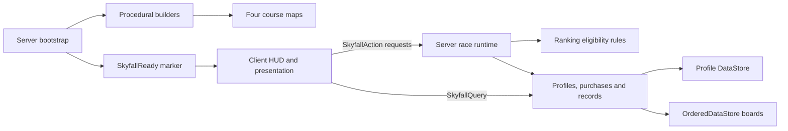

# Architecture

## Flow

## Boundaries

`SkyfallConfig` holds four course specifications, 12 obstacle patterns, movement settings, catalog definitions, persistence names and the free-skip feature flag.

`SkyfallServer` builds missing geometry before starting the race runtime. It creates `SkyfallReady` after world construction so the client does not enumerate a partially built map. Existing world geometry is preserved on ordinary game startup.

`SkyfallRuntime` owns player run state, checkpoint advancement, route gates, hazards, timing, penalties, skips and completion. The state progresses from Loading to Ready to Racing to Finished. Replaying resets current-run eligibility; a skip invalidates the current run and its campaign.

`SkyfallRules` provides a second eligibility guard at the record submission boundary. A run needs positive elapsed time, all required sections, eligibility and no skip. Times are stored as integer milliseconds for OrderedDataStore compatibility.

`SkyfallServices` owns the wallet, catalog prices, ownership checks, equipped cosmetics, profiles and record persistence. Published-game records retain the minimum time for each player. Local previews keep session records in memory.

`SkyfallClient` builds the interface and handles local camera, visual animations and moving-platform carry. Client attributes support presentation; server run state determines record submission. Local checkpoint split comparisons are temporary coaching information, not authoritative records.

## Persistence choices

- Sanitized profile data includes coins, unlocked courses, cosmetic ownership/equipment, best times and clear state.
- Unique session lease tokens reduce conflicting writes; leases renew with autosaves and expire after a bounded interval.
- Saves and record submissions retry transient failures. Shutdown waits a bounded interval for pending work.
- Failed profile loads do not overwrite saved data with defaults.
- Course versions separate ranked records after route changes. Change `RecordStorePrefix` when changing ranked geometry, and define a personal-best migration/reset policy before deploying altered courses.

These safeguards are implemented but require published, multi-server validation before being described as production-proven.

## Tradeoffs and next engineering work

The client is currently a single large UI script. Separating HUD, shop, rankings, course selection and camera into modules would improve maintainability. The runtime also combines race logic and hazard simulation; future mechanics would benefit from distinct controllers.

Basic movement checks cannot guarantee an exploit-free leaderboard. Server-verified traversal, suspicious-run review, better telemetry and adversarial testing are follow-up work. The local ferry carry improves movement feel but still relies on the normal Roblox character networking model.

The world uses procedural anchored parts for reproducibility. More detailed scenery should follow device profiling, streaming checks and draw-call measurements. Current client startup waits for server construction; streaming behavior across course transitions still needs broader physical-device coverage.

The skip prototype has a runtime grant hook for later receipt integration. Never replace it with a client purchase-success message; real developer products require idempotent server receipt handling.

## Sky rooms and edited-world source (v0.2.0)

The default project imports `src/world/SkyfallSprint.rbxm`, preserving manual island/tree edits. `Export-World.py` extracts that world from the saved Studio place; the baseline builders are fallback tooling rather than the source of the edited scene.

`CourseEnvironments.Apply` translates each whole course to its configured region without rebuilding obstacles, creates spacious persistent backdrop models, and keeps the fall catchers invisible. Relative obstacle spacing and the Z-based route gates are unchanged. The server retains control of fall returns and race eligibility.

`CourseSky` applies lighting and cloud settings locally for each player's current course. The earlier local course masking has been removed in v0.3.3; all streamed courses stay visible. Server geometry and race validation remain authoritative.

Coin visual registration and rotor registration respond to incoming streamed instances. Decorative rotor models use atomic streaming. The zoom limit is 512 studs; the environment half-width is 1,100 studs. Broad physical-device streaming and performance coverage remain follow-up work.

## Enclosed 3D worlds (v0.3.0)

This replaces the v0.2.0 approach of hiding the active enclosure. `CourseEnvironments` now builds a visible capsule-shaped shell around each route. Angular body panels and rounded end caps overlap; an unlit material provides consistent color across panel faces, preventing face-lighting seams from revealing a box. All environment parts are excluded from collision, touches and ray queries.

The shell contains real 3D themed scenery: cloud volumes and floating islands, cliff/ruin clusters, lightning/spires, or planets/rings/asteroids/stars. Those models provide depth as the camera moves. The existing hand-edited course decorations are not regenerated.

`CourseSky` keeps all streamed courses, enclosures and scenery visible and applies matching local lighting. It clears stale local transparency on non-coin parts at startup, transitions, resets, respawns and streaming additions, without changing authored/server Transparency or Enabled values. `SkyfallClient` alone owns coin visibility, with a per-player collection set retained across streaming and cleared on race reset. The saved-world source contains the new environments, and the installer recreates only its own `CourseSky` model at startup. Physical-device performance of the expanded scenery still needs profiling.

## Phase rest balance patch

`PhaseRestPlatforms.Apply` groups phase pads by section, computes the midpoint of the middle pair, and installs an anchored solid rest platform. It is idempotent and runs before the race runtime enumerates hazards and phase pads. The rest platform has no phase/crumble/movement attributes and is not a checkpoint. `RecordVersion` now scopes personal bests to `Config.Version`; global record stores use the new v4 prefix while the wallet/profile namespace is retained.
