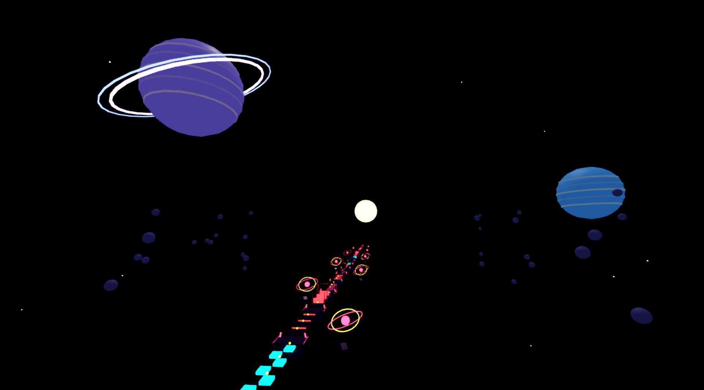
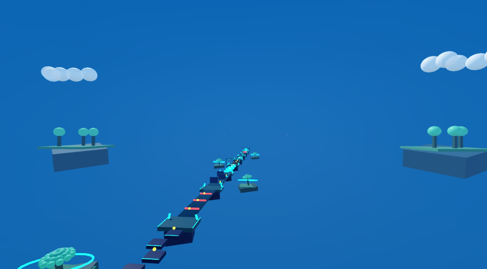

# Development history

[Back to the project overview](../README.md)

These are the detailed release and update notes previously displayed in the README. They are preserved in their original order, including the original testing limitations. Counts and wording such as “latest” describe the corresponding development stage; consult the [current overview](../README.md) and [course configuration](../src/shared/SkyfallConfig.luau) for the present scope.

The four-course tables and screenshots below document the original chapter. The project now contains twelve courses. No new gameplay validation is implied by this archive.

## The game

Race across floating courses that introduce different movement and timing ideas. Chain jumps, read solid/ghost platforms, ride moving ferries, dodge machinery, and collect optional coins for trails and auras. Checkpoints now follow two obstacle sections.

| Course | Difficulty | Sections | Length | Visual identity |
| --- | --- | ---: | ---: | --- |
| The Ascent | Easy | 8 | 768 studs | Hanging sky gardens |
| Ember Ruins | Medium | 8 | 768 studs | Maze, curved crossing and climbing terraces |
| Stormworks | Hard | 8 | 768 studs | Moving relays, elevators and wind walks |
| Solar Collapse | Expert | 8 | 768 studs | Phase timing, orbit turns and reactor escape |

**96 sections · 12 course identities · 18 cosmetics**

## Full-game visual and static QC — v0.11.1

Reviewed all 12 courses and inventoried 854 playable/collidable parts plus 203 hazard parts. The pass adds route chevrons, start/finish frames, wall seams and themed dressing while preserving the original gameplay geometry. Collapsing floors are now personal to each player, spherical hammer collision follows the sphere, and floor hazards use foot position. Other courses’ sky shells no longer show through as distant floating ceilings.

Low graphics omits optional new dressing while retaining route markers and portal frames. This was an **Edit-mode visual/source review**, not a live gameplay certification. Owner playtesting remains required. [Full report and section register](QUALITY-REVIEW.md).

## Levels 9–12 advanced chapter

Levels 1–8 are locked and preserved. The Great Engine, Cloudspire, Chrono Nexus and Skyfall Apex add rotating machinery, a 128-stud tower climb, traveling wall openings, signal floors, and combined encounters. Each new course has checkpoints after sections 2, 4 and 6, plus permanent breathing areas between challenges. Optional blue/gold branches offer risk/reward choices.

**The owner will playtest this chapter. No Play session was started for Levels 9–12.** See [advanced chapter notes](ADVANCED-9-12.md).

## Levels 5–8 expansion

Levels 1–4 are locked and preserved. Clockwork Docks, Prism Archive, Pulse Citadel, and The Convergence add 32 short sections with seven checkpoints per new course. New mechanics include powered bridges, timed laser doors, pendulum hammers, collapsing tiles, and combined lift/laser or conveyor/press sections.

**Gameplay testing is pending with the owner.** A startup/menu issue was caught and repaired during an initial Play check; full traversal was not completed before the owner requested testing stop. See [expansion notes](EXPANSION-5-8.md).

## Try the Studio prototype

[Download SkyfallRush.rbxlx](https://github.com/Alyzzini/skyfall-rush/releases/download/v0.11.1/SkyfallRush.rbxlx) from the [v0.11.1 release](https://github.com/Alyzzini/skyfall-rush/releases/tag/v0.11.1), open it in Roblox Studio, and press **Play → Enter Course → cross the blue gate**. The updated download includes the hand-edited world, enclosed 3D worlds, transparent fall catcher, source and builders. You do not need Rojo to open it.

### Route revisions (v0.11.1)

Movement uses **20 WalkSpeed / 50 JumpPower** consistently in configuration and StarterPlayer. Each course has eight focused sections, with checkpoints every two sections. Selected repeated sections become boulder hops, rounded switchbacks, a compact maze, a curved sweeper crossing, climbing terraces, vertical lifts and moving relays. Existing scenery, progression, cosmetics, timers, skips, UI and audio remain.

Following screenshot feedback, the old overlapping stair decks became six **7.5-stud balls**; sharp joins became rounded, matching-width curves; the forked rail bridge and overlapping spirals became clear single routes. Sequential route nodes enforce their intended turns. Decorative debris beyond the shortened finishes was removed. New geometry/timing uses **Rush_v7** records while currency, cosmetics, unlocks and wins retain their profile store.

The user handles gameplay testing for this revision. No Play-mode tests were run after that instruction. Earlier automated traversal attempts were incomplete and do not certify this release. [Revision details](LEVEL-DESIGN.md).

### Arcade audio and effects (v0.5.0)

Four course-specific chiptune tracks, rising coin chimes, jump/landing cues, gate starts, checkpoint melodies, spring launches, hazard returns, skip cues, shop feedback and finish/personal-best celebrations. Nearby phase/crumble/machinery cues help explain obstacles. Music fades between courses and ducks during important cues.

**Menu → Audio / FX** gives separate music/effects volumes, mute and reduced effects. Short sparkles, pulse discs and finish confetti are local and budgeted; Low mode reduces particles. [Track credits, research and implementation notes](AUDIO-VFX.md).

### HUD alignment fix (v0.4.2)

The race header, section strip, Menu and Visuals controls share one centered 1,100-pixel maximum width. Wide screens keep a single aligned status row; narrow screens place controls on a second row. The expanded race toolbar sits beneath that group.

### Ruin monuments (v0.4.1)

All six distant Ember monuments now have a fitted stone terrace, tapered floating foundation, pillar feet and capitals, supported brazier, and flush orange inlays. They face toward the course and preserve the monument locations edited in Studio. Each uses 20 anchored decorative parts, without lights, particles, collision or animation. The migration runs once and preserves later monument edits.

### Latest update: vibrant worlds, start gates and lighter rendering

- **Walk-through start gates on all four courses.** Enter Course gives control while the timer waits. Cross the blue gate toward the route to start; return behind it and cross forward again to reset. Each player has a separate server-owned timer.
- **Bright, colorful lighting:** warmer daylight, readable violet storm/space palettes, moderate saturation and restrained bloom.
- **Scene cleanup:** aligned garden layers, attached ember strips, clear distant arch openings, smaller course labels and boards facing the lobby.
- **Visuals: Auto / Low / High.** Auto reduces cosmetic effects after sustained slow frames. Low disables bloom, global shadows and decorative rotor animation, reduces coin animation frequency and removes dynamic clouds. Gameplay hazards remain identical.
- **Less background work:** only the selected sky model is pinned per player; opaque clouds reduce overdraw; fewer distant stars/ring segments; distant cosmetics sleep; empty courses stop sending motion updates. Streaming registries release removed instances.

Timing rules changed, so rankings use a fresh **Rush_v6** namespace. Coins, owned cosmetics, unlocks and wins stay in the existing profile. FPS improvement varies by device; no measured low-end FPS claim is made. See [performance notes and research](PERFORMANCE.md).

### Visibility fix (v0.3.3)

Removed whole-course transparency masking that could leave platforms invisible after switching courses or restarting. Shared obstacles remain available to all players. Lighting and collected coin visuals remain local to each player; collected coins also retain their state when streamed back in. Phase timing, transparent hazards, the hand-edited world and compact rest sizes are preserved.

### Latest balance fix: permanent phase rests

All six Phase Steps sections now have a centered, anchored **3.5 × 0.5 × 4 stud resting platform** with green edges and an **ALWAYS SOLID** sign. It never phases, crumbles or moves. The remaining phase pads retain their timing. The installer detects every phase chain and runs for saved worlds and generated worlds alike. This is a resting spot, not an extra checkpoint. The installer now migrates the old oversized platforms once, then preserves later manual Size edits instead of resetting them every startup.

### Latest update: enclosed 3D worlds

Each course is enclosed by a **visible, rounded sky shell**, with 3D scenery inside. The distant shell uses the same unlit color on every surface to disguise panel joins and avoids square wall/ceiling corners. Every course and its enclosure remain visible whenever streamed in. The enclosing scenery and course separation conceal neighboring levels without hiding their obstacles.

| Course | Surrounding 3D world |
| --- | --- |
| The Ascent | Floating garden islands, distant trees, cloud banks and a cloud sea below |
| Ember Ruins | Obsidian cliffs, glowing ember fissures, ruined arches and a setting sun |
| Stormworks | Storm-cloud volumes, steady lightning shapes, collector rings and spires |
| Solar Collapse | Ringed planets, cloud bands, asteroid fields and a surrounding star field |

The course centers remain 4,096 studs apart. The enclosure spans about 2,500 studs across and curves around both ends. Scenery sits away from the playable route and the supported 512-stud camera zoom. It cannot collide or obstruct camera ray queries. The user's edited tree islands and invisible bottom hazard remain intact.

